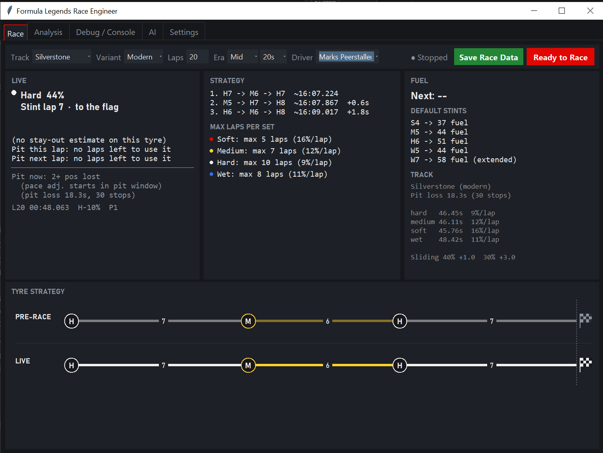
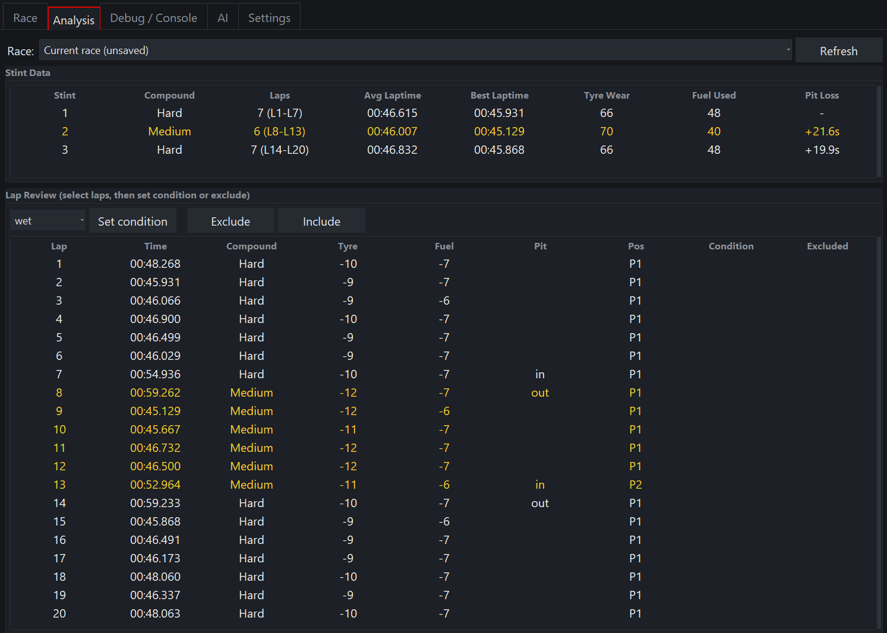

# Formula Legends Race Engineer

A race engineer for the arcade F1 game *Formula Legends*. The game has no telemetry API, so the app reads
the HUD from the screen, learns how each tyre compound behaves on each track, plans pitstop strategy
live, and talks over a voice radio backed by a local LLM.

Everything runs locally on Windows: no cloud services and no game modification.



## What it does

- **Reads the game from the screen.** Lap, lap time, fuel, tyre life, compound, position and gaps to the
  cars around you, 10 times a second, using template matching instead of OCR.
- **Learns a tyre model per track.** Lap time and wear per compound are fitted from your own saved races,
  with outlier laps (traffic, pit laps, wet laps on slicks) kept out of the fit.
- **Plans strategy.** A dynamic-programming planner finds the fastest stint plan before the race and
  re-plans from the current lap as the race unfolds, including whether pitting this lap or next is better.
- **Talks on the radio.** Spoken callouts for pit windows, fuel and gaps. Hold a key to ask a question;
  a local LLM answers from the live race state.
- **Reviews races.** Every lap is stored in SQLite. Laps can be marked wet or excluded afterwards so bad
  data never reaches the model.



## How it works

```
 screen ──> telemetry ──> strategy ──> gui
              │              │          │
              │              └──────> engineer (callouts, voice, AI)
              └──> storage (SQLite) <───┘
```

| Package | Job |
|---|---|
| `telemetry` | Grabs only the HUD regions of the game window, reads digits by glyph template matching, classifies tyre icons by ring colour, detects pause and pit screens, and turns the stream of reads into lap summaries. |
| `strategy` | Tyre model (robust regression, per-race pace offset) and the stint planner (dynamic programming over laps left). |
| `engineer` | Callout rules, text-to-speech (Kokoro), push-to-talk speech recognition (faster-whisper) and the AI engineer (Ollama). |
| `storage` | SQLite race and lap storage, user settings. |
| `gui` | Tkinter window: live race view, strategy chart, lap review, debug console. |

### Design choices worth a look

- **Template matching over OCR.** The HUD font is fixed, so matching against a small set of glyph images is
  faster and more predictable than OCR. Every read carries a confidence flag; a read is either right or
  marked unsure, never confidently wrong.
- **Lap tracking from noisy reads.** Screen reads flicker, the pit screen hides the HUD and the game blanks
  the last-lap time on track-limit violations. The lap tracker handles all of these and is covered by
  simulated-race tests.
- **An LLM that can't make numbers up.** The model answers only from a snapshot of race state. Arithmetic
  runs as real Python in a sandboxed subprocess (allow-listed syntax, no imports, 2 second limit), and a
  grounding check rejects answers containing numbers that appear in neither the snapshot nor the
  calculation. Fixed-phrase reports such as "track is wet" skip the model entirely.
- **Measured, not guessed.** A `--profile` flag times each stage of the capture loop. It showed the screen
  grab taking 70% of each cycle; grabbing only the regions that get read doubled the polling rate.

## Requirements

- Windows, with the game running at 3840x2160 (HUD positions are fixed for that resolution)
- Python 3.12+
- [Ollama](https://ollama.com) with the `qwen3.5:9b` model, for the AI engineer
- An NVIDIA GPU is recommended for speech recognition; it falls back to a smaller model on CPU
- Kokoro voice files `kokoro-v1.0.onnx` and `voices-v1.0.bin` in `models/`; without them the app uses the
  built-in Windows voice

Only the modern-era HUD is supported. The vintage HUD uses a different font.

## Setup

```
python -m venv .venv
.venv\Scripts\activate
pip install -r requirements.txt
pip install -e .[gpu]          # optional: NVIDIA libraries for GPU speech recognition
ollama pull qwen3.5:9b
```

## Running

```
python src/Main.py
```

Pick the track and race length, press **Ready to Race**, and start the race in game. Hold **V** to talk
to the engineer. After the race, review the laps in the Analysis tab and press **Save Race Data** so the
tyre model learns from it.

| Flag | Effect |
|---|---|
| `--profile` | Logs per-stage timings of the capture loop every 10 seconds |
| `--debug` | Logs every capture cycle |

Logs go to the console and `logs/race_engineer.log`.

## Tests

```
pytest
```

- Strategy, tyre model, callouts, AI tooling and database: unit tests
- Lap tracker: simulated races with pit stops, misreads and missing lap times
- Screen reading: checked against saved 4K screenshots (not in the repository, so these skip elsewhere)
- GUI: a whole race flow run against a hidden window

GitHub Actions runs `ruff` and the tests on every push.

## Tools

Scripts in `tools/` for building and debugging the screen reader:

| Script | Use |
|---|---|
| `coordinate_picker.py` | Find crop coordinates on a screenshot |
| `build_and_test.py` | Build glyph templates from labelled samples |
| `debug_capture.py`, `debug_ui_state.py`, `leaderboard_debug.py` | Dump what the reader sees right now |
| `ai_eval.py` | Score the AI engineer against a question set |
| `tts_benchmark.py` | Time the text-to-speech voices |
